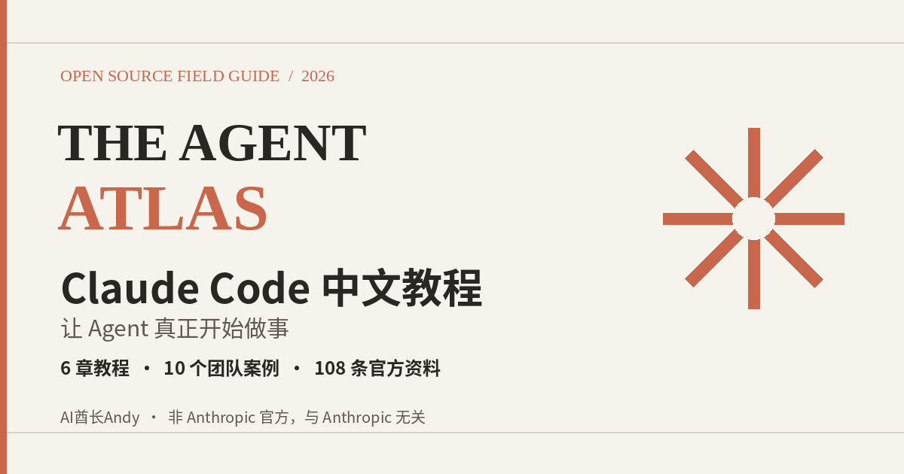

<div align="center">

# Claude Code 中文教程：Agent 实战手册

**从 Anthropic 10 个团队的公开案例，到可以照着做的 Agent 方法。**

6 章教程 · 10 个团队案例 · 6 类 Agent 架构 · 108 条官方资料 · 可复制的子 Agent / Skill 模板

免费开源。**非 Anthropic 官方，与 Anthropic 无关。**

[](https://aipmandy.github.io/anthropic-claude-code-agent-handbook/)
[](https://github.com/AIPMAndy/anthropic-claude-code-agent-handbook/stargazers)
[](LICENSE.md)
[](https://github.com/AIPMAndy/anthropic-claude-code-agent-handbook/actions/workflows/pages.yml)

[30 分钟上手](docs/00-quickstart.md) · [10 个团队](docs/01-ten-teams.md) · [Agent 架构](docs/02-agent-patterns.md) · [商业实战](docs/04-business-cases.md) · [在线阅读](https://aipmandy.github.io/anthropic-claude-code-agent-handbook/) · [深度报告](https://aipmandy.github.io/anthropic-claude-code-agent-handbook/study.html)



</div>

> **TL;DR｜一句话**：这是 AI酋长Andy 写的非官方 Claude Code 中文教程与 Agent 实战手册。它把公开资料整理成 6 章教程、10 个团队案例、6 类 Agent 架构和 108 条官方资料，并配上可复制的提示词、子 Agent 与 Skill 模板。不是 Anthropic 官方项目，也不包含其内部未公开 Prompt。
>
> 作者：AI酋长Andy（[GitHub @AIPMAndy](https://github.com/AIPMAndy) · [X @AIPMAndy](https://x.com/AIPMAndy) · [metaver.vip](https://metaver.vip/)）
>
> 微信：**AIPMAndy**（添加时请备注「Claude Code」）· [查看服务与合作](https://metaver.vip/services) · 星觉科技：[www.a6no1.cn](https://www.a6no1.cn/)。免费阅读无需添加微信，也不需要购买服务。

**想找 Claude Code 中文教程、Agent 中文实战？** 这份免费开源手册把 Anthropic 公开的团队案例和方法，拆成可以照着做的中文步骤。本项目**非 Anthropic 官方，与 Anthropic 无关**。

*English: a free, unofficial Chinese handbook for Claude Code and agents, with 6 chapters, 10 team cases, 6 agent patterns and 108 official sources. Not affiliated with Anthropic.*

## 从哪开始读

| 你是谁 | 先做什么 | 对应资料 |
| --- | --- | --- |
| 完全零基础 | 安装 CLI，完成一个文件任务 | [30 分钟上手](docs/00-quickstart.md) |
| 工程师 / 产品经理 | 探索 → 计划 → 实现 → 验证 | [Claude Code 方法](docs/03-code-playbook.md) |
| 市场 / 运营 | CSV 广告诊断 → 两个子 Agent 写创意 → 人工审核 | [营销案例](docs/04-business-cases.md) |
| 企业主 / 管理者 | 用流程卡梳理本部门可自动化的工作 | [业务落地](docs/04-business-cases.md) |
| Agent 开发者 | 判断单 Agent、并行、编排、评估是否必要 | [六种设计模式](docs/02-agent-patterns.md) |
| 想把结果做得可靠 | Evals、安全边界、回滚、人审 | [验证与安全](docs/05-evals-and-safety.md) |

想先在浏览器里看全貌，打开 [在线中文研究站](https://aipmandy.github.io/anthropic-claude-code-agent-handbook/) 或 [2024–2026 实践报告](https://aipmandy.github.io/anthropic-claude-code-agent-handbook/study.html)。

## 这份手册里有什么

| 栏目 | 数量 | 说明 |
| --- | --- | --- |
| 教程 | **6 章** | 上手、10 个团队、Agent 架构、工程方法、业务复刻、验收与安全 |
| 团队案例 | **10 个** | 来自 Anthropic 公开的部门实践，不是内部未公开材料 |
| Agent 架构 | **6 类** | 什么时候拆、怎么拆，能用脚本就先不用 Agent |
| 官方资料 | **108 条** | 按 17 个主题编目，每条可回溯到原始链接 |
| 提示词 | **3 份** | 探索、计划-实现-验证、营销 Agent |
| 可复制模板 | **2 个子 Agent、1 个 Skill** | 在 `.claude/` 目录，供对照练习 |

## 完整目录

**教程**

- [00｜30 分钟真正上手 Claude Code](docs/00-quickstart.md)
- [01｜Anthropic 内部 10 个团队怎么用 Claude Code](docs/01-ten-teams.md)
- [02｜Agent 六种架构：什么时候拆，怎么拆](docs/02-agent-patterns.md)
- [03｜Claude Code 工程实战：从一句话到能交付的结果](docs/03-code-playbook.md)
- [04｜不写代码也能复刻：营销、管理、法务、数据、产品](docs/04-business-cases.md)
- [05｜Agent 怎么验收、安全上线？](docs/05-evals-and-safety.md)

**资料与研究报告**

- [公开资料全索引（108 条）](docs/SOURCE-MATRIX.md)
- [2024–2026 完整实践进化史](docs/2024-2026-PRACTICES.md)
- [官方来源摘录](sources/official-sources.md)
- [在线站点](https://aipmandy.github.io/anthropic-claude-code-agent-handbook/) · [深度报告页](https://aipmandy.github.io/anthropic-claude-code-agent-handbook/study.html)

**可复制练习**

- [探索提示词](prompts/discover.md) · [计划-实现-验证](prompts/plan-build-verify.md) · [营销 Agent](prompts/marketing-agents.md)
- [子 Agent：资料核查](.claude/agents/source-researcher.md) · [子 Agent：质量审核](.claude/agents/quality-reviewer.md)
- [Skill：从业务到 Agent](.claude/skills/business-to-agent/SKILL.md)
- [零依赖广告分析练习](examples/ads/README.md)

## 10 个内部团队速览

| 官方报道团队 | 典型公开用法 | 可迁移能力 |
| --- | --- | --- |
| 数据基础设施 | Kubernetes 截图定位、财务文本流程、入职读代码 | 故障排查 / 非技术自动化 |
| Claude Code 产品研发 | 原型、Vim 模式、测试、PR 评论处理 | 研发闭环 |
| 安全工程 | Terraform 变更审查、故障运行手册、TDD | 安全审核 / 文档 |
| 推理 | 代码理解、边界测试、跨语言测试 | 技术能力迁移 |
| 数据科学与可视化 | 非前端背景开发 React 看板 | 数据产品化 |
| API Knowledge | 从陌生代码找到相关文件、定位问题 | 代码检索 |
| 增长营销 | 广告 CSV、文案子 Agent、Figma 批量创意、Meta Ads MCP | AI 获客 |
| 产品设计 | 截图做可交互原型、梳理状态边界 | 设计转开发 |
| RL 工程 | 小中型功能、测试、检查点与回滚 | 试错与收敛 |
| 法务 | 律师路由、会议跟踪、无障碍原型 | 非程序员做工具 |

[逐团队案例、适合任务、模仿步骤和证据出处 →](docs/01-ten-teams.md)

这些用法来自 Anthropic 已公开的团队访谈，不是内部私有系统或未公开 Prompt。

## 最短实操路线

1. 进入本目录，在命令行执行 `claude`。第一次使用先阅读 [安装指南](docs/00-quickstart.md)。
2. 把业务需求写入一个 Markdown 文件，而不是一句“帮我全自动做完”。
3. 请求先扫描文件、提出验收标准，不立即改动。
4. 先做 **单 Agent** 的最小可用版本；只有任务可并行、可独立验证时，才拆分成子 Agent。
5. 以测试结果、人工抽检、git diff / 输出文件为验收，而不是“AI 说完成了”。

### 零 API、零依赖演练

下面这个模拟广告分析案例，不必先开通 Claude 订阅，也能先跑通“确定性分析”部分；接入 Claude Code 后，再练习如何让专门的 Agent 基于指标提出创意建议。

```bash
python3 scripts/ad_audit.py --input examples/ads/sample_ads.csv --output outputs/ad_report.csv
python3 -m unittest discover -s tests -v
```

所有广告数据均为**人工构造的教学数据**，不是 Anthropic 或客户的真实账户。输出只是待改进广告的指标标记，不会自动调用模型、投放广告或承诺收益。详见 [练习步骤](examples/ads/README.md)。

## 为什么做这个项目

2025 年 7 月，Anthropic 发布《How Anthropic teams use Claude Code》。官网文章是概要；其公开 PDF 详述了 **10 个部门**如何使用 Claude Code，包括增长营销、法务、设计、数据、产品、安全和基础设施团队。

本手册在此基础上，整理 Anthropic 官方公开的 Agent 方法、Claude Code 文档与 2024–2026 年长任务实践，改写成中文可执行教程。**本项目非 Anthropic 官方，与 Anthropic 无关；不包含其内部私有源码、数据或未公开 Prompt。**

## 阅读规则与版权

- **[官方报道]**：只记录公开材料明确说过的做法，并附原始链接与时间。
- **[我们复刻]**：提示词、检查清单、模板、样例数据和代码由本手册作者编写，不能当成 Anthropic 内部资产。
- **[建议/推断]**：来自方法抽象，需要用自己的真实流程验证。
- 不转载 Anthropic 原文全文、原版 PDF 或其图片；提供摘要和原始链接。不保证收录了 Anthropic 未公开的全部实践。
- 操作细节可能随版本变化，以 [Claude Code 官方最新文档](https://code.claude.com/docs/en/overview) 为准。

项目文本与代码许可见 [LICENSE.md](LICENSE.md)。代码部分为 MIT License。

## 作者

**AI酋长Andy**（Andy Liu，GitHub / X [@AIPMAndy](https://github.com/AIPMAndy)）。星觉科技。手册本身免费开源。

- 微信：`AIPMAndy`（备注「Claude Code」）
- [查看服务与合作](https://metaver.vip/services)
- [个人官网 metaver.vip](https://metaver.vip/)
- [星觉科技 www.a6no1.cn](https://www.a6no1.cn/)
- [更多免费开源项目](https://github.com/AIPMAndy)

欢迎提交可复现的新案例、勘误与原始证据。最后核查：2026-11-10。
